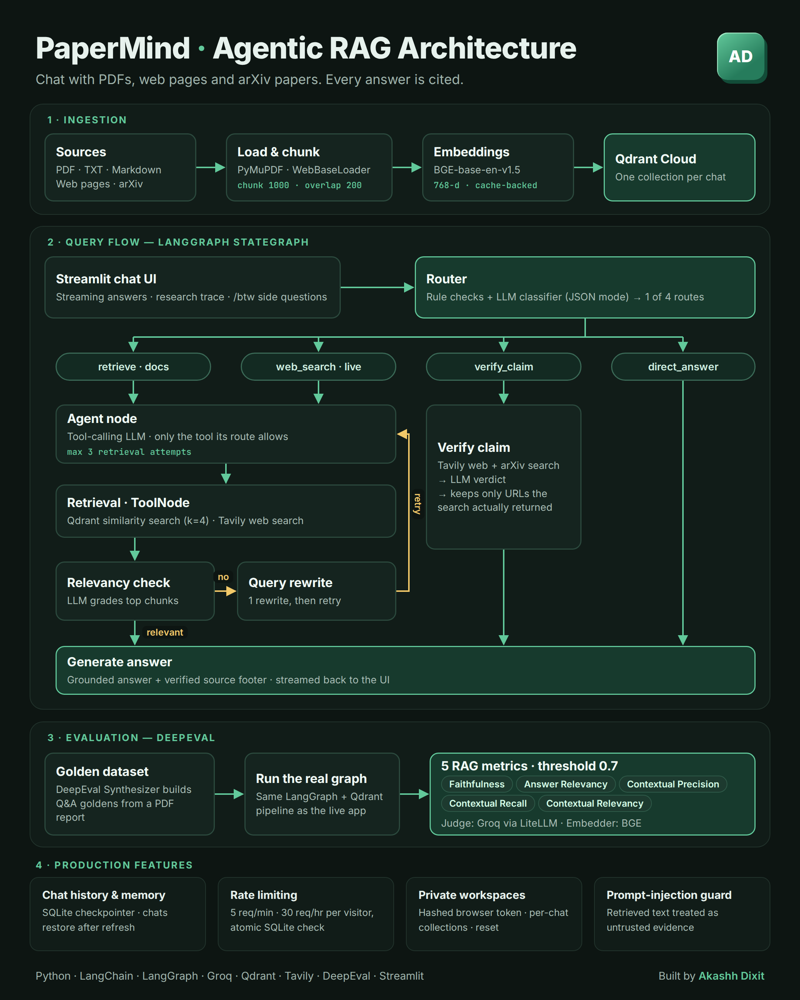

# PaperMind

### An agentic RAG research assistant for documents, web pages, and arXiv papers

PaperMind helps researchers move from scattered sources to grounded answers. Add a PDF, text file, Markdown document, web page, or arXiv paper; ask a question; and receive a streamed response with a clear source trail.

> **Try it live:** [papermind-ybhjwaq8v7pjh4yc3cc2gd.streamlit.app](https://papermind-ybhjwaq8v7pjh4yc3cc2gd.streamlit.app/)

> **Portfolio showcase:** This repository presents PaperMind's product capabilities and architecture. The production source code and deployment configuration remain private.

---

## Why PaperMind?

A traditional document chatbot retrieves text and generates an answer. Research questions need more judgment:

- Is the answer supported by my documents?
- Does the question require current information from the web?
- Has a claim been superseded by newer research?
- Which source actually supports the response?

PaperMind addresses these questions with an agentic workflow that chooses the right evidence path before answering.

## What it can do

- **Chat with multiple source types** — work with PDF, TXT, Markdown, web pages, and arXiv papers.
- **Route questions intelligently** — distinguish between indexed-document retrieval, live-web research, claim verification, and direct answers.
- **Show grounded sources** — identify whether an answer came from indexed documents, live web evidence, verification results, or general model knowledge.
- **Check evidence quality** — grade retrieved passages for relevance before generating a response.
- **Recover from weak retrieval** — rewrite an unsuccessful document query and try again.
- **Verify research claims** — compare a claim against current web and arXiv evidence and surface potentially superseding work.
- **Stream responses** — display the answer progressively for a faster, more natural research experience.
- **Summarize uploads** — provide quick highlights after a document is indexed.
- **Remember the conversation** — preserve recent context so follow-up questions remain meaningful.
- **Restore private chats** — maintain browser-scoped workspaces and chat history across refreshes.
- **Expose the research trace** — show the selected route and the amount of evidence used for each answer.
- **Support side questions** — use `/btw` for quick questions without changing the main research thread.

## Architecture

PaperMind is organized around four stages:

1. **Ingestion** — sources are loaded, split into focused passages, converted into semantic embeddings, and stored in an isolated vector collection.
2. **Agentic query flow** — a router selects the appropriate research path; retrieved evidence is checked for relevance before an answer is generated.
3. **Evaluation** — the real retrieval-and-generation workflow is assessed with a synthetic golden dataset and five RAG quality metrics.
4. **Production safeguards** — private workspaces, conversation persistence, rate limiting, and prompt-injection defenses support safer public use.

## Research workflow

| Route | When it is used | Result |
| --- | --- | --- |
| **Indexed documents** | The question refers to an uploaded or loaded source | Retrieves semantically relevant passages and answers from that evidence |
| **Live web** | The question asks for recent or current information | Searches the web and returns an evidence-backed response |
| **Claim verification** | The user asks whether a research claim is still valid | Checks current web and arXiv results and produces a structured verdict |
| **Direct answer** | The question does not require document or live-web evidence | Responds from model knowledge and labels the source accordingly |

For indexed sources, weak evidence triggers one query rewrite before the final answer. This improves retrieval without creating an uncontrolled retry loop.

## Evaluation

PaperMind includes a repeatable evaluation workflow built around the same pipeline used by the live application. It can generate question-and-answer goldens from a research document and assess results across five dimensions:

- Faithfulness
- Answer relevancy
- Contextual precision
- Contextual recall
- Contextual relevancy

Each metric uses a **0.7 acceptance threshold**. The evaluation setup is designed to measure both answer quality and retrieval quality without claiming unverified benchmark scores.

## Privacy, safety, and reliability

- Each browser receives an isolated workspace with separately scoped chats and vector collections.
- Only a hash of the browser-held visitor token is stored for workspace ownership.
- Retrieved documents, page content, titles, and search snippets are treated as untrusted evidence to reduce prompt-injection risk.
- Request limits protect shared model and search quotas from rapid repeated use.
- Clear failure states are shown when evidence is missing, irrelevant, unreadable, or incompatible.
- Users can explicitly reset their own workspace, including chats and indexed documents.

> **Public demo note:** Uploaded documents may be cleared during maintenance or application restarts. Avoid uploading confidential or sensitive material to the public demo.

## Technology

| Area | Technology |
| --- | --- |
| User experience | Streamlit |
| Agent orchestration | LangGraph and LangChain |
| Language models | Groq-hosted models |
| Vector database | Qdrant Cloud |
| Embeddings | BAAI BGE base English v1.5 |
| Live research | Tavily |
| Persistence | SQLite checkpoints and chat metadata |
| Evaluation | DeepEval and LiteLLM |

## Built by

**Akashh Dixit**

[GitHub](https://github.com/AkashhDixit) · [Live PaperMind app](https://papermind-ybhjwaq8v7pjh4yc3cc2gd.streamlit.app/)

---

If PaperMind helps your research workflow, consider starring the repository.
